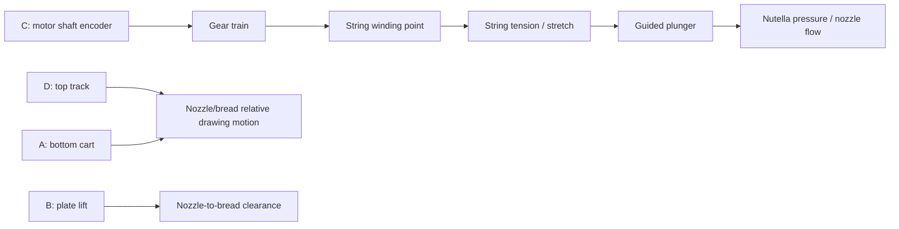

# Mechanical understanding from the six reference photographs

Sources: `tests/reference/photos/attachments.zip`, images `1000105556.jpg`
through `1000105561.jpg` in the same ignored local directory.
All six were inspected, with enlarged views of the string path and exposed gears.
Photos establish visible structure, not measured gear ratios or movement signs.

## Axes and dispensing

- The two side towers support a horizontal rack/track. The syringe assembly
  rides on this top assembly: X is nozzle left/right motion.
- The yellow/blue platform sits on a separate bottom cart/track: Y is relative
  forward/back motion of the workpiece, rather than another nozzle axis.
- The plate's vertical lift is a separate mechanism identified by the owner and
  existing code. Its complete transmission is obscured beneath the plate in
  these images, so its exact linkage and limits remain unverified.
- The syringe barrel and nozzle are held in the lower frame of the head.
  Dispensing pushes the syringe plunger into that barrel. This is distinct
  from moving the entire nozzle toward the bread.
- A tall guided structure above the barrel carries the plunger pushing action.
  The exposed string runs from an upper attachment down to a winding location
  near the lower gear axle. Combined with the owner's description, winding
  pulls the guided plunger assembly downward. The complete concealed string
  routing and each internal moving joint cannot be resolved from still photos.
- The reset is manual, as described by the owner. Unwinding a pulling string
  is not equivalent to actively lifting the plunger, so automatic reverse
  retraction/reset is not assumed by the controller.

Only the motor shaft is directly measured in the C chain above. The remaining
steps can introduce motion or flow errors invisible to that encoder.

## What each photo establishes

- **5556:** side view of the long vertical guide, upper string attachment,
  descending string, wound string beside/between the black gears, syringe,
  and work platform. This is the clearest view of the winding mechanism.
- **5557:** rear/side relationship between the head, upper track, support
  pieces, and platform. Several shafts and connections are occluded.
- **5558:** front view of the syringe cage and nozzle, graduated barrel, and
  row of meshing gray gears. The barrel's printed marks are visible but are
  not enough to calibrate displacement or accurately infer bore diameter.
- **5559:** upper/rear guide structure and head mounting on the rack assembly.
- **5560:** overall layout and separation between top head movement and bottom
  platform movement.
- **5561:** front overall view, bottom cart track, upper track, and brick.
  It confirms the two perpendicular relative drawing motions.

## Consequences for precision

### String winding radius is not constant

The white string is visibly bunched in multiple wraps at the lower black
gear/axle area. The exact winding surface is partly hidden; it cannot be
assumed to be a smooth, constant-radius drum. If another wrap builds on an
existing one, take-up length per shaft degree increases. Settlement, a knot,
or contact with gear teeth can change tension and friction too.

Consequently, a single motor-degrees-per-line-length calibration would be an approximation. It
should be tested over the intended short operating stroke and repeated with
the same winding arrangement. If line thickness changes as the spool fills,
fixing the winding geometry or measuring plunger position is preferable to
simply changing motor timing.

### Priming and zeroing solve different problems

Zeroing the encoder at an arbitrary hand-reset position removes the previous
job's numerical angle, but does not remove slack. A future syringe startup can
begin at the owner's manual top reference (beams vertical, upper cylinders at
the yellow marker), then prime forward until actual flow is observed. Encoder
zero can then represent the flow reference. The original main program does not
currently implement priming or automatic dispensing.

This adapts to initial slack/contact differences that disappear while priming.
It cannot identify hidden slip, later stretching, a changed winding radius,
or different Nutella viscosity. The operator must still confirm actual flow.

### Torque and flow cannot be inferred from encoder motion alone

Several exposed gray gears appear similar in size. Multiple meshing gears
alone do not prove a torque reduction: equal-sized idlers mainly transmit
motion and change direction. Hidden gears or compound shafts may change the
ratio, so the effective input-to-winding ratio must be measured rather than
declared from these photos.

A reduction in requested speed can reduce required flow rate, but it does not
increase the transmission's mechanical advantage. A larger driven gear/smaller
driver, or a smaller winding radius, can increase available string force at
the expense of speed. Those are mechanical changes requiring measurement.

The brick reported low battery during inspection. Assess motor force only
after charging/replacing batteries. Guide friction, alignment, frame flex,
and nozzle resistance are also plausible loads; the photographs do not prove
which is the primary cause.

### Motor feedback is necessary but not full plunger odometry

Pybricks motor commands use motor encoders internally. The original main program
does not add a shared reference controller or synchronize a syringe with X/Y.
Encoder readings cannot detect a freely spinning motor with a slipping string
or distinguish plunger motion from string stretch.

For more repeatability, first investigate a smooth winding surface with
repeatable single-layer routing and a consistent manual starting arrangement.
A plunger top switch on an unused input could confirm a repeatable manual reset
reference. A direct plunger position sensor would provide stronger feedback
throughout the stroke; a top switch alone does not measure ongoing extrusion.

## Measurements still needed

The original X/Y spans and plate timing remain the working baseline; they do
not require replacement calibration for the syringe work. Investigate:

1. Winding input/output ratio, approximate winding radius, and whether wraps
   remain on one layer over a useful dispensing stroke.
2. Plunger movement for a known motor angle after slack is removed, repeated
   at multiple starting positions.
3. Actual flow at a repeatable drive rate and usable plunger stroke with
   a margin before the physical end. Observe short test lines before full art.
